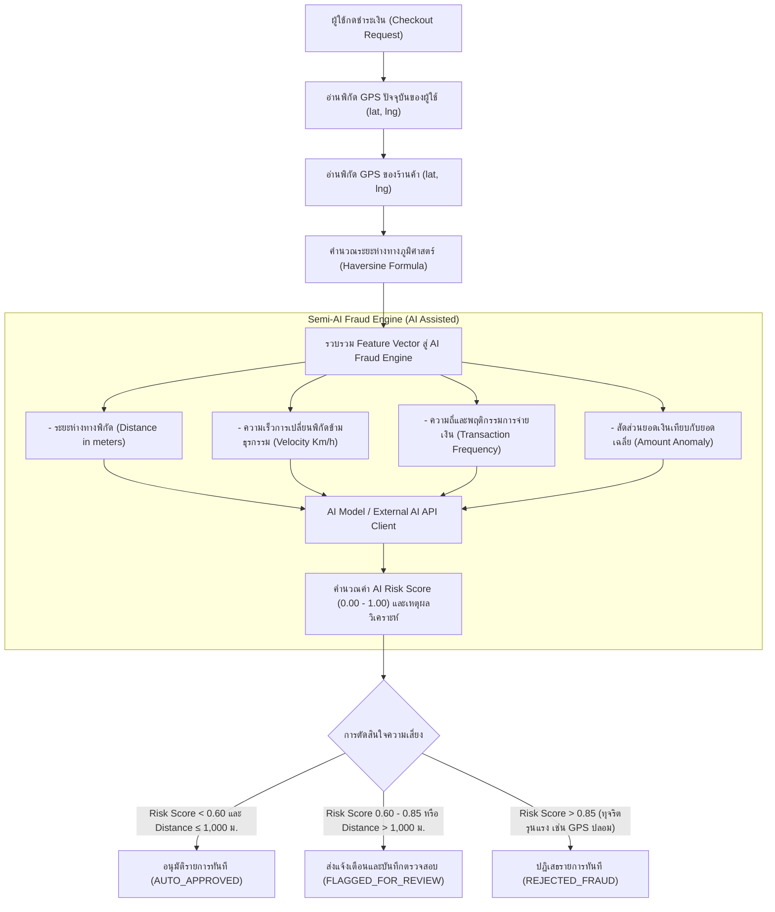

# 💳 Developer 2: Payment & Fraud Engine Specification
## โครงการแพลตฟอร์มดิจิทัลเพื่อการกระตุ้นเศรษฐกิจ "ไทยช่วยไทยพลีส" (THAI Please)

เอกสารนี้รวบรวมข้อกำหนดการวิเคราะห์ ออกแบบระบบ และมาตรฐานการพัฒนา สำหรับ **Developer 2 (Fintech Core, Payment, Wallet & Fraud Detection)** ตามที่ระบุในเอกสารโครงการ THAI Please Web Application

---

## 📌 1. ขอบเขตความรับผิดชอบของ Developer 2

| โมดูล / หน้าเพจ | รหัส Use Case | กลุ่มผู้ใช้ | หน้าที่หลัก |
| :--- | :--- | :--- | :--- |
| **หน้าหลักกระเป๋าเงิน (Wallet Dashboard)** | `UC-02` / `FR-CIT-02` | ประชาชน | แสดงยอดเงินส่วนตัว, โควตารัฐสมทบ 60% คงเหลือประจำวันและรวมโครงการ, ปุ่มเติมเงิน, ทางลัดไปสแกนจ่าย |
| **หน้าสแกนชำระเงินร่วม (Co-pay 60/40)** | `UC-02` / `FR-CIT-02` | ประชาชน | สแกน Dynamic QR ของร้านค้า, คำนวณสัดส่วน Co-pay 60/40 อัตโนมัติ, ตรวจจับพิกัด GPS แบบ Real-time |
| **หน้าหลักฐานการชำระเงิน (e-Slip)** | `UC-02` | ประชาชน | ออกใบเสร็จอิเล็กทรอนิกส์ขอบหยักมน สไตล์ e-Slip ทางการเงิน แสดงรายละเอียด 60/40 และพิกัดยืนยันความปลอดภัย |
| **หน้าประวัติการทำธุรกรรมประชาชน** | `FR-CIT-05` | ประชาชน | ประวัติการชำระเงินร่วม / การเติมเงิน พร้อมสถานะและสิทธิ์ประเมินรีวิว 24 ชม. |
| **หน้าสร้างคิวอาร์โค้ดรับชำระเงิน (Dynamic QR)** | `UC-06` / `FR-MER-01` | ร้านค้า | ร้านค้ากำหนดราคา, ดึงพิกัด GPS ร้าน, สร้าง Dynamic QR 300x300 px ระบุสัดส่วน Co-pay ให้ลูกค้าสแกน |
| **หน้าประวัติการรับเงินและสถิติการขาย** | `FR-MER-04` | ร้านค้า | แสดงยอดขายประจำวัน, สรุปยอดเงินอุดหนุนจากรัฐ (60%) และเงินที่ได้รับจากลูกค้า (40%) |
| **ระบบตรวจจับทุจริต GPS & Semi-AI** | `UC-09` / `FR-ADM-03` | ผู้ดูแลระบบ | ประมวลผลพิกัด Geofence (Haversine) ร่วมกับ AI Fraud Anomaly Scoring, รายการแจ้งเตือน Admin และปุ่มจัดการ |

---

## 🧮 2. กฎการคำนวณระบบชำระเงินร่วมจ่าย (Co-pay 60/40 Engine)

โครงการ THAI Please กำหนดอัตราส่วนการร่วมจ่าย:
- **รัฐบาลสมทบ (Government Co-pay):** 60%
- **ประชาชนจ่ายเอง (Citizen Co-pay):** 40%

### เงื่อนไขโควตาจำกัด (Quota Constraints)
1. **วงเงินสิทธิรัฐสมทบสูงสุดต่อวัน (`daily_quota_limit`):** 150.00 บาท / วัน
2. **วงเงินสิทธิรัฐสมทบรวมทั้งโครงการ (`total_quota_limit`):** 3,000.00 บาท ตลอดระยะเวลาโครงการ
3. **การรีเซ็ตโควตารายวัน:** หากข้ามวันใหม่ (`CURRENT_DATE > last_quota_reset_date`) ยอด `daily_quota_used` จะถูกรีเซ็ตเป็น 0.00 บาทโดยอัตโนมัติ

### สูตรการคำนวณ (Formula Calculation)
ให้ $T$ คือยอดรวมค่าสินค้าและบริการ (`total_amount`)
1. คำนวณสัดส่วน 60% ในเบื้องต้น:
   $$G_{tentative} = T \times 0.60$$
2. ตรวจสอบโควตารัฐที่ใช้ได้ในวันนั้น:
   $$\text{Daily Remaining} = \max(0, \text{daily\_quota\_limit} - \text{daily\_quota\_used})$$
   $$\text{Total Remaining} = \text{total\_quota\_remaining}$$
   $$\text{Max Government Allowable} = \min(G_{tentative}, \text{Daily Remaining}, \text{Total Remaining})$$
3. ยอดที่รัฐบาลสมทบจริง (`government_copay_amount`):
   $$G = \text{Max Government Allowable}$$
4. ยอดที่ประชาชนต้องจ่ายจริง (`citizen_paid_amount`):
   $$C = T - G$$
   *(ประชาชนจะจ่าย 40% หากไม่เกินโควตารัฐ หรือจ่ายมากกว่า 40% หากยอด 60% เกินโควตารัฐคงเหลือ)*

---

## 🛰️ 3. สถาปัตยกรรมระบบตรวจจับทุจริตพิกัด GPS & Semi-AI (Fraud Engine)

ระบบตรวจจับทุจริตถูกออกแบบเป็น **Hybrid Geolocation & Semi-AI Anomaly Detection** โดย**ไม่พึ่งพา Hardcoded Rule-based เพียงอย่างเดียว**

### การเชื่อมต่อกับ AI API (Semi-AI Design Pattern)
- **AI Fraud Client Interface (`AiFraudClient`):** รองรับการส่ง Features ไปยัง AI Endpoint ภายนอก (เช่น Google Gemini API, Custom ML Anomaly Microservice)
- **Fallback / Local Smart Heuristic Scoring:** ในระหว่างที่ยังไม่ผูก API Key ปลายทาง ระบบมี Intelligent AI Simulation Model ที่ประเมิน Anomaly Score ตามข้อมูลพฤติกรรมจริง ไม่ตัดสิทธิ์ด้วยเงื่อนไขแข็งทื่อ
- **Admin Review Queue:** ผู้ดูแลระบบสามารถดูแผนที่เปรียบเทียบพิกัด วิเคราะห์ความน่าจะเป็น และกด Overwrite/Approve ได้จากหน้า Dashboard

---

## 📡 4. ข้อกำหนด API Endpoints (ตามเอกสารระบบ)

### 4.1 กระเป๋าเงิน (Wallet)
- `GET /api/wallet/balance`: ตรวจสอบยอดเงินกระเป๋าและโควตาสิทธิรัฐสมทบ
- `POST /api/wallet/top-up`: จำลองการเติมเงินเข้ากระเป๋าเงินประชาชน

### 4.2 ระบบชำระเงินและคิวอาร์โค้ด (Payment & QR)
- `POST /api/payment/qr/generate`: ร้านค้าสร้าง Dynamic QR Code (ยอดเงิน + พิกัด GPS)
- `GET /api/payment/qr/:reference`: ตรวจสอบข้อมูล QR Code ก่อนชำระเงิน
- `POST /api/payment/qr/checkout`: ประชาชนยืนยันชำระเงินร่วม (คำนวณ Co-pay 60/40 + GPS & Semi-AI Check)

### 4.3 ประวัติธุรกรรม (Transactions)
- `GET /api/transactions/buyer/history`: ประวัติการสั่งซื้อและสิทธิการรีวิว 24 ชม. ของประชาชน
- `GET /api/transactions/merchant/history`: สรุปยอดขาย ประวัติการรับเงินของร้านค้า
- `GET /api/transactions/:id/slip`: ข้อมูลสลิปหลักฐานการชำระเงิน

### 4.4 ระบบตรวจจับทุจริตสำหรับ Admin (Fraud Detection)
- `GET /api/fraud/alerts`: ดึงรายการธุรกรรมที่ถูก Flagged พร้อมพิกัดและ AI Risk Score
- `POST /api/fraud/resolve/:id`: ผู้ดูแลระบบบันทึกผลการตรวจสอบ (Approve / Reject)

---

## 🎨 5. ข้อกำหนด UX/UI ภาษาไทย (ตาม ux-ui-design-system.md)

1. **การใช้ภาษา:** UI ทั้งหมดเป็นภาษาไทยที่เป็นมิตร ชัดเจน เข้าใจง่ายสำหรับประชาชนทุกช่วงวัย
2. **Typography:** ฟอนต์หลัก `Sarabun` พร้อม `line-height` ขั้นต่ำ `1.5` ป้องกันสระและวรรณยุกต์ลอย
3. **ตัวเลขทางการเงิน:** ใช้ฟอนต์ Monospace (`font-mono`) ในยอดเงิน ยอด Co-pay และสลิป
4. **Pill Geometry:** ปุ่มกดทุกปุ่มใช้ `rounded-pill` หรือ `rounded-full`
5. **Interactive State:** ทุกปุ่มต้องมีสถานะชัดเจน (Default, Hover, Active, Disabled, Loading Spinner) ไม่ก่อให้เกิดข้อผิดพลาดบน Console
