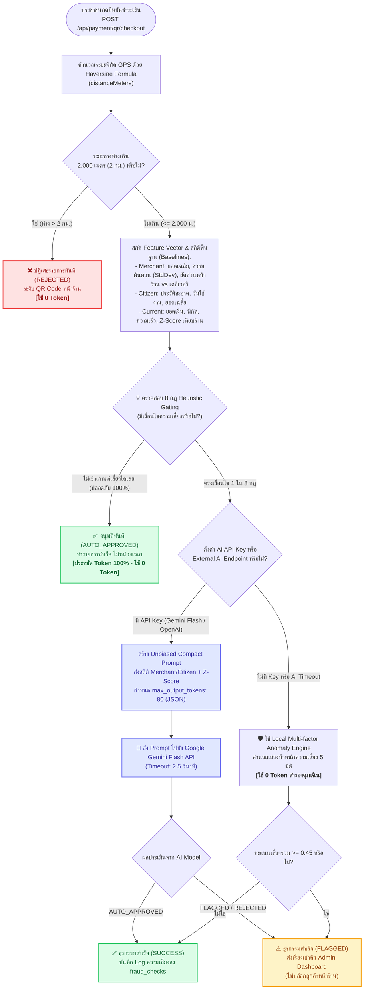

# 🤖 กฎการตัดสินใจส่ง Prompt AI และระบบป้องกันการสิ้นเปลือง Token & ไบแอส
## (AI Fraud Decision Rules, Baseline Profiling & Zero-Token Gating)
### แพลตฟอร์มดิจิทัล "ไทยช่วยไทยพลีส" (THAI Please WebApp)

---

## 🎯 1. วัตถุประสงค์และหลักการออกแบบ (Core Philosophy)
ในระบบการเงินร่วมจ่าย Co-pay ที่มีปริมาณธุรกรรมระดับประเทศ (High-throughput):
1. **Zero-Token First:** ธุรกรรมปกติกว่า 90–95% ต้องผ่านการอนุมัติแบบ Real-time โดย**ไม่ส่ง Prompt เข้าโมเดล AI เลย (ใช้ 0 Token)** เพื่อลดต้นทุนและป้องกันความล่าช้าหน้าเคาน์เตอร์ร้านค้า
2. **Context-Aware & Anti-Bias (ป้องกันอคติ):** 
   - ไม่ตัดสินจากบิลเดี่ยวและไม่ส่งข้อความชี้นำเชิงลบ (Anchoring Bias) เข้า AI
   - นำ **สถิติพื้นฐานของร้านค้า (Merchant Baseline)** เช่น ยอดใช้จ่ายเฉลี่ย, ค่าความผันผวนของยอดเงิน (Std Dev), และสัดส่วนลูกค้าหน้าร้าน vs ออเดอร์เดลิเวอรี/LINE OpenChat ในชุมชน มาเปรียบเทียบเสมอ
   - ให้ AI มองหาเหตุผลการค้าขายปกติก่อน (Devil's Advocate Policy) เพื่อคุ้มครองพ่อค้าแม่ค้าที่ขายอาหารทางแชตหรือส่งตามบ้านในระยะไม่เกิน 2 กม.
3. **Non-blocking Policy:** AI ไม่มีอำนาจสั่งบล็อกการค้าขายของร้านค้าและประชาชนทันที หากพบความน่าสงสัย จะอนุมัติให้ชำระเงินสำเร็จ แต่ติดสถานะ `FLAGGED_FOR_REVIEW` เข้าสู่คิวงานของผู้ดูแลระบบ (Admin) เพื่อตรวจสอบย้อนหลัง

---

## 📊 2. แผนภาพ Flowchart การตัดสินใจส่ง Prompt (Decision Flowchart)



---

## 📋 3. ตาราง 8 กฎการตัดสินใจส่ง Prompt (Heuristic Gating Matrix)

| ลำดับกฎ | ชื่อกฎ (Rule Identifier) | เงื่อนไขการตัดสินใจ (Trigger Condition) | เหตุผลความเสี่ยง (Risk Rationalization) | นโยบาย Anti-Bias |
| :--- | :--- | :--- | :--- | :--- |
| **กฎที่ 1** | `NEAR_GEOFENCE_LIMIT` | `distanceMeters > 1500` (แต่ $\le 2000$) | พิกัดเริ่มใกล้ขอบเพดาน 2 กม. อาจใช้ GPS Spoofing หรืออยู่นอกร้าน | หากร้านมีลูกค้าหน้าร้าน $\ge 65\%$ และยอดปกติ จะระบุเป็นออเดอร์เดลิเวอรีชุมชน |
| **กฎที่ 2** | `ABNORMAL_VELOCITY` | `estimatedSpeedKmH > 70` | เคลื่อนที่ข้ามธุรกรรมด้วยความเร็วสูงผิดปกติ (เสี่ยงแชร์บัญชี) | ส่ง AI วิเคราะห์เส้นทางและความเป็นไปได้ |
| **กฎที่ 3** | `HIGH_FREQUENCY_BURST` | `recentTxCountIn10Min >= 3` | สแกนจ่ายถี่ผิดวิสัย (มากกว่า 2 ครั้งใน 10 นาที) | ส่ง AI วิเคราะห์รูปแบบเวลา |
| **กฎที่ 4** | `SPLIT_BILLING_SUSPICION` | `samePairRepeatCountToday >= 3` | สแกนร้านเดิมซ้ำมากกว่า 2 ครั้งใน 1 วัน (เสี่ยงซอยบิลแลกเงินสด) | ส่ง AI ประเมินเจตนาธุรกรรม |
| **กฎที่ 5** | `REPEATED_OFFENSE_HISTORY` | `repeatedSuspiciousCount >= 1` | ผู้ใช้หรือร้านค้านี้เคยมีประวัติถูก Flagged สะสม | ส่ง AI ตรวจสอบพฤติกรรมย้อนหลัง |
| **กฎที่ 6** | `HIGH_VALUE_HIGH_DISTANCE`| `amount > 1500` และ `distanceMeters > 1000` | ยอดเงินสูงเกิน 1,500 บาท ร่วมกับระยะทางห่างร้านเกิน 1 กม. | ส่ง AI ประเมินมูลค่าสินค้าเทียบกับพิกัด |
| **กฎที่ 7** | `AMOUNT_VOLATILITY_OUTLIER` | `amountZScoreVsMerchant > 3.0` | ยอดเงินบิลนี้ผันผวนสูงกว่าค่าเฉลี่ยร้านค้าเกิน 3 เท่าของส่วนเบี่ยงเบนมาตรฐาน ($Z > 3$) | เทียบกับยอดเฉลี่ยและสถิติของร้านค้าจริง |
| **กฎที่ 8** | `LOW_IN_STORE_RATIO` | `totalTx >= 10` และ `inStoreRatio < 0.30` | ร้านค้ามีสัดส่วนลูกค้าหน้าร้านต่ำผิดปกติ (< 30%) เสี่ยงเป็นร้านตัวแทน/ฮั้ว | ป้องกันร้านค้าผีที่ไม่มีหน้าร้านจริง |

---

## 📝 4. ข้อกำหนดโครงสร้าง Prompt แบบลดความลำเอียง (Anti-Bias Minimal Prompt)

### 4.1 System Instruction (Neutral & Devil's Advocate)
```text
You are an objective fraud evaluator for Thailand Co-pay. Evaluate risk without bias. 
Commercial context: neighborhood delivery, LINE OpenChat orders, and takeaway within 2km are normal if merchant has healthy in-store ratio (>=60%) and realistic ticket sizes. 
Evaluate amount volatility against merchant/citizen average and std dev. 
Output ONLY valid JSON: {
  "riskScore": number(0-1), 
  "decision": "AUTO_APPROVED" | "FLAGGED_FOR_REVIEW", 
  "reason": "สรุปสั้นๆภาษาไทย 1 ประโยค อธิบายความสมเหตุสมผลเชิงสถิติ"
}. 
Never return REJECTED.
```

### 4.2 Compact User Prompt (ส่ง Baseline สถิติแบบกระชับ)
```text
TxData: amt=180THB, dist=1612m, spd=15km/h, 10mTx=1, sameShopToday=1, flags=0
MerchantBase: avgAmt=160THB (std=35), inStoreRatio=85%, uniqCust=60, zScore=0.57
CitizenBase: totalTx=25, avgAmt=150THB (std=30), cleanRatio=100%, acctDays=120
Observations: [พิกัดห่าง 1612 ม. (อยู่ในระยะส่งเดลิเวอรี/ออเดอร์แชตชุมชน)]
```

* **ผลการวินิจฉัยจาก AI:**
  ```json
  {
    "riskScore": 0.03,
    "decision": "AUTO_APPROVED",
    "reason": "พิกัด 1.6 กม. สอดคล้องกับออเดอร์เดลิเวอรี/แชตชุมชน โดยร้านค้ามีสัดส่วนหน้าร้านปกติสูงถึง 85% และยอดเงินอยู่ในกรอบปกติ"
  }
  ```

---

## 👥 5. การรวมกลุ่มแฟ้มคดีระดับบุคคล/ร้านค้า (User & Merchant Dossiers)
* **ตัดสัญญาณรบกวน (Noise Suppression):** บิลย่อยเดี่ยวๆ (< 150 บาท) ไม่นำขึ้นแสดงในคิวหลักของ Admin
* **เกณฑ์ส่งต่อเข้าคิว Admin:** ทำซ้ำ $\ge 2$ ครั้ง หรือเสี่ยงเงินสมทบ $\ge 300$ บาท หรือ Risk Score $\ge 0.80$
* **Batch 1-Click Action:** Admin ตรวจสอบภาพรวมทั้งร้านหรือผู้ใช้ และกด Approve All หรือ Suspend ได้ในคลิกเดียว

---

## 🛠️ 6. ไฟล์ที่เกี่ยวข้องในระบบ (Developer 2 Scope)
* **คลาสคำนวณและประเมินความเสี่ยง:** [`server/src/services/fraud.service.ts`](file:///d:/Y4/THAI_Please_WebApp/server/src/services/fraud.service.ts)
* **การคำนวณ Co-pay และจุดตัด Geofence:** [`server/src/services/payment.service.ts`](file:///d:/Y4/THAI_Please_WebApp/server/src/services/payment.service.ts)
* **ชุดทดสอบ Unit Tests:** [`server/src/tests/payment-engine.test.ts`](file:///d:/Y4/THAI_Please_WebApp/server/src/tests/payment-engine.test.ts)
