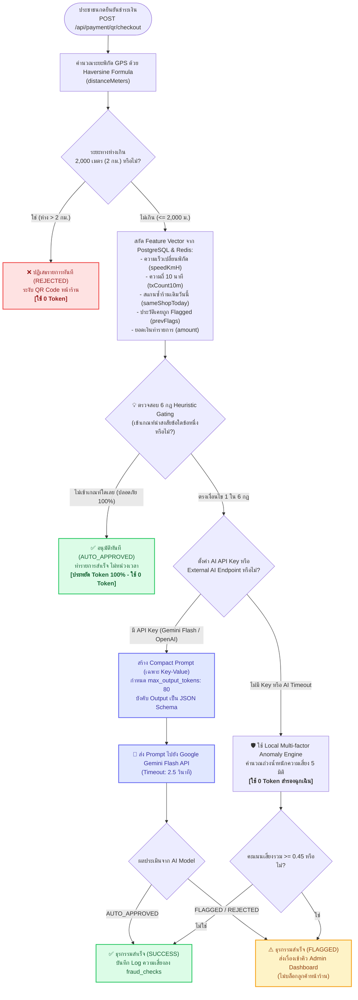

# 🤖 กฎการตัดสินใจส่ง Prompt AI และระบบป้องกันการสิ้นเปลือง Token
## (AI Fraud Decision Rules & Zero-Token Gating Architecture)
### แพลตฟอร์มดิจิทัล "ไทยช่วยไทยพลีส" (THAI Please WebApp)

---

## 🎯 1. วัตถุประสงค์และหลักการออกแบบ (Core Philosophy)
ในระบบการเงินร่วมจ่าย Co-pay ที่มีปริมาณธุรกรรมระดับประเทศ (High-throughput):
1. **Zero-Token First:** ธุรกรรมปกติกว่า 90–95% ต้องผ่านการอนุมัติแบบ Real-time โดย**ไม่ส่ง Prompt เข้าโมเดล AI เลย (ใช้ 0 Token)** เพื่อลดต้นทุนและป้องกันความล่าช้าหน้าเคาน์เตอร์ร้านค้า
2. **Targeted AI Reasoning:** ส่ง Prompt เรียกโมเดล AI ภายนอก (เช่น Google Gemini Flash) เฉพาะกรณีที่มีความผิดปกติหรือพฤติกรรมน่าสงสัยซ้ำๆ (Gray Zone)
3. **Non-blocking Policy:** AI ไม่มีอำนาจสั่งบล็อกการค้าขายของร้านค้าและประชาชนทันที (ยกเว้นพิกัดอยู่นอกเกณฑ์ 2 กม.) หากพบความน่าสงสัย จะอนุมัติให้ชำระเงินสำเร็จ แต่ติดสถานะ `FLAGGED_FOR_REVIEW` เข้าสู่คิวงานของผู้ดูแลระบบ (Admin) เพื่อตรวจสอบย้อนหลัง

---

## 📊 2. แผนภาพ Flowchart การตัดสินใจส่ง Prompt (Decision Flowchart)



---

## 📋 3. ตาราง 6 กฎการตัดสินใจส่ง Prompt (Heuristic Gating Matrix)

หากธุรกรรมไม่ผ่านข้อใดข้อหนึ่งในตารางนี้ ระบบจะตัดสินใจ**เรียกส่ง Prompt เข้า AI ทันที**:

| ลำดับกฎ | ชื่อกฎ (Rule Identifier) | เงื่อนไขการตัดสินใจ (Trigger Condition) | เหตุผลความเสี่ยง (Risk Rationalization) | การจัดการ Token |
| :--- | :--- | :--- | :--- | :--- |
| **กฎที่ 1** | `NEAR_GEOFENCE_LIMIT` | `distanceMeters > 1500` (แต่ $\le 2000$) | พิกัดเริ่มใกล้ขอบเพดาน 2 กม. อาจใช้ GPS Spoofing หรืออยู่นอกร้าน | ส่ง AI วิเคราะห์ร่วมกับพฤติกรรมอื่น |
| **กฎที่ 2** | `ABNORMAL_VELOCITY` | `estimatedSpeedKmH > 70` | มีการเคลื่อนที่ระหว่าง 2 ธุรกรรมด้วยความเร็วสูงผิดปกติ (เสี่ยงแชร์บัญชี) | ส่ง AI วิเคราะห์เส้นทางและความเป็นไปได้ |
| **กฎที่ 3** | `HIGH_FREQUENCY_BURST` | `recentTxCountIn10Min >= 3` | สแกนจ่ายถี่ผิดวิสัยการซื้อสินค้าหน้าร้านทั่วไป (มากกว่า 2 ครั้งใน 10 นาที) | ส่ง AI วิเคราะห์รูปแบบเวลา |
| **กฎที่ 4** | `SPLIT_BILLING_SUSPICION` | `samePairRepeatCountToday >= 3` | ผู้ใช้คนเดิมสแกนร้านเดิมซ้ำมากกว่า 2 ครั้งใน 1 วัน (สงสัยการซอยบิลแลกเงินสด) | ส่ง AI ประเมินเจตนาธุรกรรม |
| **กฎที่ 5** | `REPEATED_OFFENSE_HISTORY` | `repeatedSuspiciousCount >= 1` | ผู้ใช้หรือร้านค้านี้เคยมีประวัติถูก Flagged หรืออยู่ในรายการเฝ้าระวัง | ส่ง AI ตรวจสอบพฤติกรรมย้อนหลัง |
| **กฎที่ 6** | `HIGH_VALUE_HIGH_DISTANCE`| `amount > 1500` และ `distanceMeters > 1000` | ยอดเงินสูงเกิน 1,500 บาท ร่วมกับระยะทางห่างร้านเกิน 1 กม. | ส่ง AI ประเมินมูลค่าสินค้าเทียบกับพิกัด |

---

## 📝 4. ข้อกำหนดโครงสร้าง Prompt (Strict JSON & Compact Template)

เพื่อป้องกันการเปลือง Token จากคำตอบที่ยาวเกินไป ระบบใช้โครงสร้างแบบ **Minimal Token Engineering**:

### 4.1 System Instruction
```text
You are an anti-fraud risk engine for Thailand Co-pay. Evaluate risk. Output ONLY valid JSON: {"riskScore": number(0-1), "decision": "AUTO_APPROVED"|"FLAGGED_FOR_REVIEW", "reason": "สรุปสั้นๆภาษาไทย 1 ประโยค"}. Never return REJECTED directly; always FLAGGED_FOR_REVIEW if suspicious.
```

### 4.2 Compact User Prompt (ประหยัด Token สูงสุด)
ส่งเฉพาะตัวแปรสำคัญในรูปแบบ Key-Value บรรทัดเดียว:
```text
TxFeatures: dist=1650m, speed=95km/h, tx10m=4, sameShopToday=3, prevFlags=2, amt=800THB, triggers=[พิกัดห่าง 1650 ม.; ความเร็วการเคลื่อนที่ผิดปกติ (95 กม./ชม.)]
```

### 4.3 พารามิเตอร์การเรียกใช้งาน (Generation Config)
* `maxOutputTokens`: **80** (จำกัดคำตอบไม่เกิน 80 tokens ป้องกันคำอธิบายเวิ่นเว้อ)
* `temperature`: **0.1** (ต้องการผลลัพธ์ที่นิ่งและเป็นระเบียบตาม JSON Schema)
* `responseMimeType`: `"application/json"`
* `timeout`: **2,500 ms** (หาก AI ตอบช้าเกิน 2.5 วินาที ระบบจะตัดจบและใช้ Local Engine แทนทันที)

---

## 💰 5. การประเมินความคุ้มค่าและผลลัพธ์ (Token Savings & Latency Benchmark)

| มิติการเปรียบเทียบ | แบบเดิม (ยิง AI ทุกธุรกรรม) | แบบใหม่ (Zero-Token Gating) | ผลลัพธ์ที่ปรับปรุงได้ |
| :--- | :--- | :--- | :--- |
| **สัดส่วนการเรียก AI API** | 100% ของทุกธุรกรรม | **~ 5% – 8%** (เฉพาะธุรกรรมที่น่าสงสัย) | 🟢 **ลดการยิง API ลง 92% – 95%** |
| **การใช้ Token ต่อ 10,000 รายการ** | ~ 2,500,000 Tokens | **~ 125,000 Tokens** | 🟢 **ประหยัด Token ได้กว่า 95%** |
| **เวลาตอบสนองหน้าร้าน (Latency)** | หน่วง 1,200 – 2,500 ms ทุกรายการ | **< 5 ms** สำหรับ 95% ของรายการทั่วไป | ⚡ **สแกนจ่ายได้ลื่นไหล ไม่ต้องยืนรอ** |
| **ความเสี่ยงระบบล่มจาก Rate Limit** | สูงมากเมื่อมีคนสแกนพร้อมกัน | ต่ำมาก เพราะกรองที่แอปพลิเคชันก่อน | 🛡️ **ระบบรองรับโหลดสูงได้อย่างมั่นคง** |

---

---

## 👥 7. การรวมกลุ่มแฟ้มคดีและการตัดสัญญาณรบกวน (User & Merchant Dossier Rollup)

เพื่อแก้ไขปัญหา **Alert Fatigue** ของผู้ดูแลระบบ (ป้องกันไม่ให้ Admin ต้องตรวจบิลย่อยเป็นล้านรายการ):

### 7.1 กฎตัดสัญญาณรบกวนธุรกรรมย่อย (Micro-transaction Noise Suppression)
* **Isolated Single Tx (< 150 บาท):** บิลย่อยเดี่ยวๆ ที่ไม่มีประวัติทำซ้ำ จะถูกบันทึกเงียบๆ (Silent Audit Log) โดย**ไม่นำขึ้นแสดงในคิวหลักของ Admin**
* **เกณฑ์ส่งต่อเข้าคิว Admin (Actionable Criteria):**
  1. `flaggedCount >= 2` (ทำซ้ำตั้งแต่ 2 รายการขึ้นไป)
  2. `governmentCopayAtRisk >= 300` (ยอดเงินรัฐสมทบ 60% ที่เสี่ยงสูญเสียสะสม $\ge$ 300 บาท)
  3. `maxRiskScore >= 0.80` (มีความผิดปกติรุนแรง เช่น วาร์ปข้ามเขต หรือความเร็วผิดมนุษย์)

### 7.2 แฟ้มคดีระดับบุคคล/ร้านค้า (AI Case Dossiers)
* รวบรวมธุรกรรมที่น่าสงสัยตาม `userId` และ `merchantId`
* AI สังเคราะห์พฤติกรรมภาพรวมเป็น **Executive Summary 1-2 ประโยค** (เช่น ส่อเจตนาซอยบิลแลกเงินสด, แชร์บัญชี)
* รองรับปุ่มจัดการแบบ **Batch 1-Click Action:**
  * `APPROVE_ALL`: อนุมัติทุกบิลในแฟ้มคดีในคลิกเดียว
  * `SUSPEND_USER`: ระงับสิทธิ์ Co-pay ประชาชนรายนี้
  * `SUSPEND_MERCHANT`: ระงับสิทธิ์ร้านค้าเพื่อส่งเจ้าหน้าที่ลงพื้นที่

---

## 🛠️ 8. ไฟล์ที่เกี่ยวข้องในระบบ (Code Mapping)

* **คลาสและตรรกะการตัดสินใจ:** [`server/src/services/fraud.service.ts`](file:///d:/Y4/THAI_Please_WebApp/server/src/services/fraud.service.ts)
  * ฟังก์ชันตัดสินใจส่ง Prompt: `shouldInvokeAi(features)`
  * ฟังก์ชันรวบรวมแฟ้มคดีและตัด Noise: `getFraudDossiers(includeMinorNoise)`
  * ฟังก์ชันจัดการเคสแบบ Batch: `resolveDossier(params)`
* **API Endpoints:** [`server/src/routes/fraud.routes.ts`](file:///d:/Y4/THAI_Please_WebApp/server/src/routes/fraud.routes.ts)
  * `GET /api/fraud/dossiers`
  * `POST /api/fraud/dossier/resolve`
* **หน้า UI ผู้ดูแลระบบ:** [`client/src/pages/admin/fraud-alerts/AdminFraudAlertsPage.tsx`](file:///d:/Y4/THAI_Please_WebApp/client/src/pages/admin/fraud-alerts/AdminFraudAlertsPage.tsx)
* **การตั้งค่า Environment:** [`server/src/config/env.ts`](file:///d:/Y4/THAI_Please_WebApp/server/src/config/env.ts) และ [`server/.env`](file:///d:/Y4/THAI_Please_WebApp/server/.env)
* **ชุดทดสอบความถูกต้อง:** [`server/src/tests/payment-engine.test.ts`](file:///d:/Y4/THAI_Please_WebApp/server/src/tests/payment-engine.test.ts#L112-L162)
