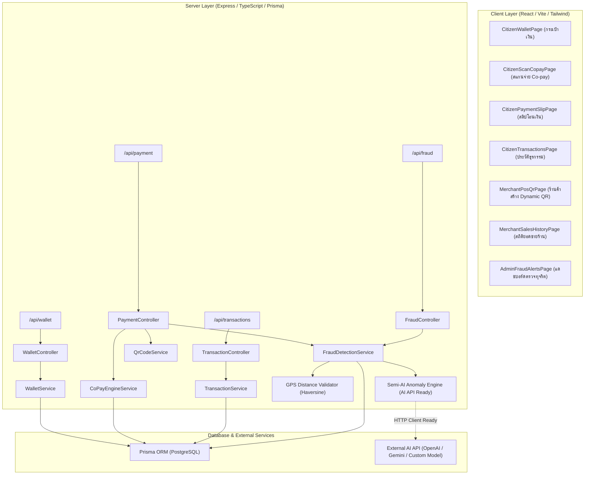

# 🧠 คู่มือทักษะและความเชี่ยวชาญ (Skill Specification)
## Developer 2: Payment & Fraud Engine
### โครงการแพลตฟอร์มดิจิทัล "ไทยช่วยไทยพลีส" (THAI Please WebApp)

---

## 🎯 1. พันธกิจและภาพรวม (Mission & Overview)
ความเชี่ยวชาญนี้มุ่งเน้นการพัฒนาระบบแกนกลางทางการเงิน (Fintech Core) และระบบความปลอดภัยขั้นสูงสำหรับแพลตฟอร์ม THAI Please ซึ่งประกอบด้วย:
1. **ระบบกระเป๋าเงินดิจิทัล (Digital Wallet):** บริหารจัดการยอดเงินผู้ใช้, สิทธิ์โครงการ, และจำลองการเติมเงิน
2. **ระบบชำระเงินร่วมจ่าย (Co-pay 60/40 Engine):** คำนวณการแบ่งจ่ายระหว่างรัฐบาล (60%) และประชาชน (40%) ภายใต้เพดานโควตารายวัน 150 บาท และเพดานรวม 3,000 บาท
3. **ระบบสร้างและสแกนคิวอาร์โค้ด (Dynamic QR Payment):** ร้านค้าสร้าง QR ระบุยอดเงินและพิกัด พร้อมระบบสแกนตรวจสอบยอดและยืนยันชำระเงิน
4. **ระบบตรวจจับการทุจริตพิกัด GPS และกึ่งปัญญาประดิษฐ์ (GPS & Semi-AI Fraud Detection Engine):** ตรวจสอบระยะห่าง Geofence ระหว่างพิกัดร้านค้ากับผู้ใช้ และวิเคราะห์คะแนนความเสี่ยงผิดปกติ (Anomaly Risk Score) โดยเตรียม Interface สำหรับต่อเชื่อม AI API ภายนอก (ไม่ใช่ Rule-based แข็งทื่อ)
5. **ระบบออกใบเสร็จอิเล็กทรอนิกส์ (e-Slip):** สร้างหลักฐานการชำระเงินที่ปลอดภัย สามารถตรวจสอบย้อนหลังได้

---

## 📐 2. มาตรฐานการพัฒนาซอฟต์แวร์ระดับสากล (Global Dev Standards)

1. **Clean & Layered Architecture:**
   - **Domain / Entity Layer:** นิยาม Data Models, กฎทางธุรกิจ และ Type Definitions ที่เป็นอิสระ
   - **Service / Application Layer:** รวม Business Logic (Co-pay calculation, Quota tracking, Haversine formula, AI risk evaluator)
   - **Controller & Route Layer:** ตรวจสอบ Request Data ผ่าน Zod Validation และส่งต่อให้ Service
   - **UI / Presentation Layer:** React + TypeScript + TanStack Query + Tailwind CSS ออกแบบตาม Coinbase Design System

2. **Zero-Bug Regression Policy:**
   - ทุกครั้งที่มีการแก้บั๊ก ต้องไม่ก่อให้เกิดบั๊กใหม่ (ห้ามสร้างบั๊กใหม่)
   - เพิ่ม Unit Test และการทดสอบกรณีขอบเขต (Edge Cases) ก่อนรวมโค้ดเสมอ

3. **High Accessibility & UI/UX Standards (ตาม `docs/ux-ui-design-system.md`):**
   - **ภาษาไทยเป็นหลัก:** ข้อความ ป้ายกำกับ คำเตือน และคำอธิบายเป็นภาษาไทยที่สุภาพ ชัดเจน
   - **Sarabun Font:** กำหนด `line-height >= 1.5` เพื่อป้องกันปัญหาสระและวรรณยุกต์ลอย
   - **Monospace Numbers:** ยอดเงิน บาท ตัวเลขทศนิยม ใช้ `font-mono` ตัวเลขอ่านง่ายตรงหลัก
   - **Pill Shape:** ปุ่มกดใช้รูปทรงมน `rounded-pill` หรือ `rounded-full`
   - **Interactive State Testing:** ปุ่มทุกปุ่มต้องมี State ชัดเจน (Hover, Active, Disabled, Loading) และไม่พังเมื่อกดซ้ำ

---

## 🏗️ 3. แผนผังระบบและส่วนประกอบ (Component Architecture)

---

## 🧪 4. แผนการทดสอบระบบแบบหน่วยย่อย (Granular Testing Strategy)

1. **Unit Tests (Business Logic & Math):**
   - คำนวณ Co-pay 60/40 เมื่อยอดเงินไม่เกินโควตารายวัน (150 บาท)
   - คำนวณ Co-pay 60/40 เมื่อยอดเงินเกินโควตารายวัน (ประชาชนต้องจ่ายส่วนเกิน)
   - ตรวจสอบการรีเซ็ตโควตารายวันเมื่อข้ามวัน
   - คำนวณระยะห่างพิกัด GPS ด้วย Haversine Formula เทียบกับระยะ 500m, 1,000m, 10,000m
   - ประเมินคะแนนความเสี่ยง Semi-AI Anomaly Score และการตัดสินใจ Flagged / Auto-Approved

2. **Integration Tests (API Endpoints):**
   - ตรวจสอบ `GET /api/wallet/balance`
   - ตรวจสอบ `POST /api/wallet/top-up`
   - ตรวจสอบ `POST /api/payment/qr/generate`
   - ตรวจสอบ `GET /api/payment/qr/:reference`
   - ตรวจสอบ `POST /api/payment/qr/checkout` (Success Flow & Geofence Warning Flow)
   - ตรวจสอบ `GET /api/fraud/alerts` & `POST /api/fraud/resolve/:id`

3. **UI Interaction & Button Tests:**
   - ทดสอบทุกปุ่มในฝั่งประชาชน (สแกนจ่าย, ยืนยันชำระ, เติมเงิน, กรองประวัติ, บันทึกสลิป)
   - ทดสอบทุกปุ่มในฝั่งร้านค้า (สร้าง QR, สลับยอดเงิน, รีเฟรช QR)
   - ทดสอบทุกปุ่มในฝั่ง Admin (อนุมัติรายการทุจริต, ปฏิเสธรายการ, เปิดดูแผนที่พิกัด)
   - ตรวจสอบว่าไม่มี Uncaught Exception บน Browser Console
